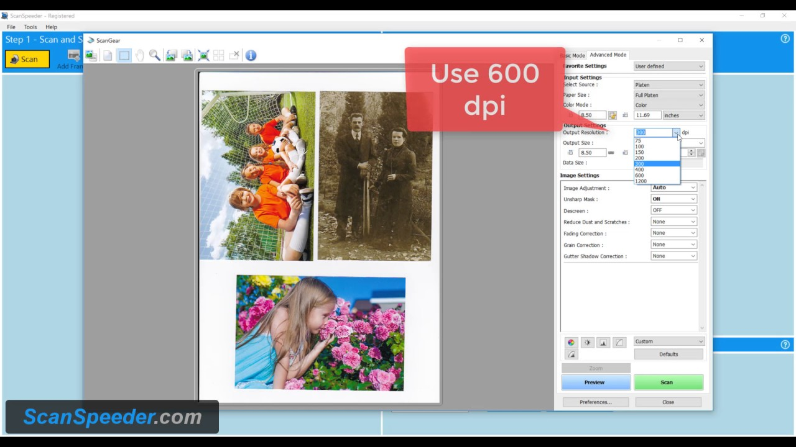
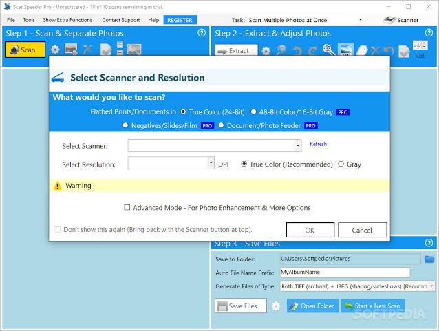
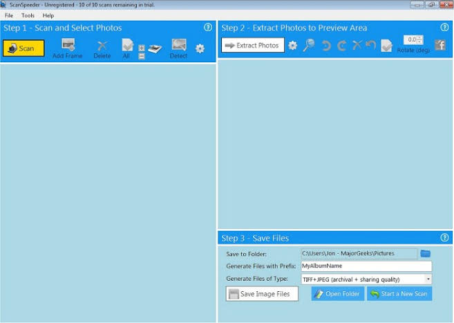

# ScanSpeeder: A Box of Prints, Digitized Carefully

Turn a mixed box of photographs into individual images with enough context to find them again.
ScanSpeeder combines multi-photo scanning, automatic extraction, enhancement, and captioning in a Windows workflow.

## Keep the full scan before separating the pictures

Treat the scanner-bed image as a record of the capture.
Individual photographs can then be extracted and corrected without losing the original arrangement.
ScanSpeeder's update history documents saving the source scan as well as the separated photos.

Choose a small representative batch before processing an entire collection.
Include a faded print, a photograph with a white border, and a picture with important detail near an edge.

### Translate a physical print size into pixels

This standalone Python calculation estimates the pixel dimensions of a six-by-four-inch print at 600 DPI.
It also estimates uncompressed RGB pixel storage at eight bits per channel.
File size will additionally depend on compression, metadata, and the actual output format.

```python
width_inches, height_inches = 6, 4
dpi = 600
width_px = round(width_inches * dpi)
height_px = round(height_inches * dpi)
rgb_bytes = width_px * height_px * 3
print(f"{width_px} x {height_px} pixels")
print(f"RGB pixel data: {rgb_bytes / 1024**2:.1f} MiB")
```

Increasing a stored DPI label alone does not recover detail absent from the scan.
Choose acquisition settings according to the print and intended use.
Avoid repeatedly resampling the archival copy.

[](https://scanspeeder-portable.github.io/ScanSpeeder-Pro/)

## Inspect every detected photograph before extraction

ScanSpeeder can identify several photographs within one scan and extract separate, straightened images.
Check the proposed boundaries before accepting the batch.
A successful detection still needs to preserve the content you care about.

### Look beyond the central subject

- Check faces, hands, and writing close to the edges.
- Decide whether a printed border belongs in the saved image.
- Look for two photographs accidentally treated as one region.
- Check small pictures that differ greatly from the rest of the batch.
- Confirm the orientation after extraction.

The documented album workflow uses Extract Photos in Step 2.
It also allows working from album pages rather than requiring every photograph to be removed.
Inspect the capture for glare, uneven focus, and background areas before extracting the images.



### Separate rotation, selection, and image scale

Fine rotation corrects a slightly crooked photograph.
A quarter-turn corrects a sideways image.
Cropping decides what content remains, while resolution describes a different property.

The companion gImageReader assets [angle.svg](data/icons/angle.svg), [rotate_page.svg](data/icons/rotate_page.svg), and [rotate_pages.svg](data/icons/rotate_pages.svg) represent orientation-related interface controls.
[select.svg](data/icons/select.svg) and [thumbnail.svg](data/icons/thumbnail.svg) are selection and thumbnail resources.
[resolution.svg](data/icons/resolution.svg) is a separate resolution-control asset.

An incorrectly cropped edge may require returning to the saved source scan.

## Restore a viewing copy while retaining the evidence

ScanSpeeder provides one-click enhancement and additional image-adjustment controls.
Its update history includes batch adjustments for color, contrast, gamma, brightness, saturation, and sharpening.
Compare a corrected copy with the source before applying the same treatment to unrelated prints.

### Judge restoration on the actual photograph

An old portrait and a faded landscape may need different treatment.
Inspect skin tones, pale clothing, and deep shadows.
Stronger contrast can make a preview look clearer while concealing subtle detail.

Keep a neutral source when the print's original appearance matters.
Use a corrected version for a slideshow or family presentation.
Record a meaningful correction in the catalog if another person may need to understand it later.



The companion [brightness.svg](data/icons/brightness.svg), [contrast.svg](data/icons/contrast.svg), and [controls.svg](data/icons/controls.svg) are gImageReader interface assets.
They provide examples of separately represented adjustment controls.
Their presence does not establish an image-restoration algorithm.

### Match the source material to the scanner

A reflective print and a film negative require different capture arrangements.
ScanSpeeder Pro's film workflow still depends on scanner hardware capable of scanning the film.
Check the scanner's film holder, illumination, and driver options before attempting a batch.

The official Epson film guide describes a compatible scanner workflow.
Use instructions appropriate to your own scanner model.
A software edition cannot supply optical hardware that the scanner lacks.

## Add the story while someone still remembers it

Capture names, places, occasions, and approximate dates while that information is available.
Mark uncertainty explicitly rather than turning a guess into a precise date.

ScanSpeeder's Caption field can embed descriptive information that appears as the photo title in Windows Explorer.
The vendor documents using that title to search and sort photographs.
Check one saved file in your intended viewing application before captioning a large batch.

### Keep a small catalog alongside the images

This original Python example writes a separate UTF-8 CSV record.
Replace the sample values with information about your own exported photograph.
The x mode requires a new filename, avoiding replacement of an existing catalog.

```python
import csv
fields = ["file", "people", "date_note", "place"]
record = {"file": "album03_014.tif", "people": "Mira; Leon",
          "date_note": "circa 1978", "place": "family garden"}
with open("photo-catalog.csv", "x", newline="", encoding="utf-8-sig") as output:
    writer = csv.DictWriter(output, fieldnames=fields)
    writer.writeheader()
    writer.writerow(record)
```

The CSV is a companion catalog, not a ScanSpeeder project or embedded image metadata.
Keep its file identifier consistent when creating a JPEG derivative.
Store a transcription of writing on the reverse when it contributes useful context.

A separate text record remains useful when a destination strips metadata.
Retain the original wording as well as any corrected spelling.
For uncertain identities, record who supplied the information.

## Save an archival image and a practical sharing copy

ScanSpeeder documents saving TIFF and JPEG together.
Choose the destination and filename prefix before committing the batch.
Reopen examples of both outputs to check orientation, dimensions, and captions.

| Saved item | Intended role | What to retain |
| --- | --- | --- |
| Full source scan | Revisit extraction or original placement | The complete scanned area |
| TIFF photograph | Further editing and archival use | Useful captured detail and metadata |
| JPEG photograph | Sharing and everyday viewing | A readable image at practical size |
| Catalog record | Preserve identification and context | Stable filenames and explicit uncertainty |

Use a consistent base name for the two versions.
Keep the source batch identifiable when several prints look similar.

### Build a visual index of a completed batch

With ImageMagick available, this command makes a three-column contact sheet from your exported JPEG copies.
The thumbnails fit within 220-by-160-pixel cells with spacing around them.
Use an unused output filename outside the input pattern.

```sh
magick montage "album03_*.jpg" -thumbnail 220x160 -tile 3x -geometry +8+8 "album03-index.png"
```

The contact sheet is a visual index, not a replacement for the individual images.
Check the complete photographs when judging focus, fine detail, or crop accuracy.



## Handle printed text as a separate recognition task

Postcards, receipts, album labels, and typed notes may benefit from OCR.
Recognition needs a readable capture and the correct language.
Proofread names, dates, and numbers against the image.

ScanSpeeder's update history documents Pro OCR improvements for cards and receipts.
Confirm the available document and searchable-output features in your installed edition.
A searchable text layer does not establish that every recognized character is correct.

### Follow a documented OCR workflow

The companion gImageReader [index.md](docs/index.md) describes its text and hOCR capabilities.
[2_Usage.md](docs/2_Usage.md) explains importing images, selecting recognition areas, and reviewing results.
[3_Add_language.md](docs/3_Add_language.md) concerns Tesseract language definitions.
[4_Add_dictionary.md](docs/4_Add_dictionary.md) concerns spelling dictionaries.

The language-data [README.txt](packaging/win32/skel/share/tessdata/README.txt) and dictionary [README.txt](packaging/win32/skel/share/hunspell/README.txt) document separate resources.
[LangTables.hh](common/LangTables.hh) contains language-name mappings.
[5_Options.md](docs/5_Options.md) describes output-pane and language-data preferences.

### Keep the page image and recognized structure distinct

The companion [autolayout.svg](data/icons/autolayout.svg) represents layout analysis.
[proofread.svg](data/icons/proofread.svg) and [wconf.svg](data/icons/wconf.svg) are proofreading and word-confidence interface resources.
The structure-oriented assets include [item_page.svg](data/icons/item_page.svg), [item_block.svg](data/icons/item_block.svg), [item_line.svg](data/icons/item_line.svg), and [item_word.svg](data/icons/item_word.svg).

An image region and a recognized word should remain distinguishable in a mixed document.
[item_halftone.svg](data/icons/item_halftone.svg) represents an image-related layout element.
[stripcrlf.svg](data/icons/stripcrlf.svg) is a text-cleanup resource.
Check reading order and line breaks when a document contains several columns.

The companion [PaperSize.hh](common/PaperSize.hh) defines paper-size and unit interfaces.
[CCITTFax4Encoder.hh](common/CCITTFax4Encoder.hh) declares an encoding interface for bilevel image data.
That document-oriented representation serves a different purpose from preserving a full-color photograph.

## Leave enough information for the next person

Record the scanner model, capture settings, batch identifier, and any unusual corrections.
Keep source scans, extracted photographs, sharing copies, and the catalog clearly named.

The companion manual templates are [manual.html.in](data/manual.html.in), [manual-ru.html.in](data/manual-ru.html.in), and [manual-cs.html.in](data/manual-cs.html.in).
The collection's [COPYING](COPYING) contains GPL version 3 text, while [copyright](packaging/debian/copyright) records packaging copyright and license information.

Consult ScanSpeeder's official [album-scanning guide](https://scanspeeder.com/blog/articleid/51/scan-photos-from-photo-albums),
[scanner-driver page](https://scanspeeder.com/scanners),
and [update history](https://scanspeeder.com/updates) for native features and controls.

## Related Search Terms

ScanSpeeder Portable, ScanSpeeder Pro, scan speeder, nitro logic scanspeeder, scanspeeder software, scanner, image-processing, digitalization, scanned-documents, ocr, tesseract-ocr, pdf, twain, wia, windows
